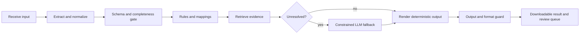

# Business-First Workflow Design

Use this reference before designing or materially changing a business workflow. It is
especially relevant to multi-template, compliance-sensitive, file-driven, or
human-review workflows.

## 0. Make the First Conversation Visual

Do not give a new user a long requirements form. Present a small discovery board first:

- Offer 3-5 mutually exclusive starting goals as selectable cards or buttons.
- Show one compact flow that changes with the selection: input, evidence/rule boundary,
  output, and human handoff.
- Show at most three live facts: proposed scope, the non-negotiable answer/output
  boundary, and the next missing decision.
- Ask only 1-3 questions that change the branch. Defer metadata, model choice, and full
  configuration until a user has selected a goal.

Use a local interactive visualization when selection materially changes the proposed
workflow. Use Mermaid when a static branch diagram is enough. The first screen should
help users recognize their own business problem, not teach every Dify node.

### Discovery Board Visual Rules

- Give each selectable option a distinct, low-saturation theme-aware accent; keep the
  accent stable for that option in the flow and the selected summary. Use color to convey
  category or selection, never decoration.
- Give every option three readable layers: a small sequence label, a short goal name, and
  one plain-language outcome. Avoid paragraphs inside choice cards.
- Use an 8px layout rhythm: 8px within a compact text group, 12-16px between peer choices,
  and 16-24px between stages. Keep cards at 8px radius or lower.
- Use one clear selected state plus native keyboard focus. Do not rely on color alone;
  preserve an outline, border, or pressed state.
- Use a constrained type scale: normal body text, compact supporting text, and one modest
  selected-state heading. Do not use hero typography in a workflow discovery surface.
- Keep the primary diagram broad and shallow. On a narrow screen, stack the choices first;
  do not shrink essential labels until they are unreadable.

## 1. Write the Application Brief First

Capture these items in a compact table before editing a DSL. Ask only about items that
cannot be inferred from the existing app, sample data, or templates.

| Item | Record | Why it matters |
|---|---|---|
| User action | What is uploaded, selected, or requested | Defines the start variables and source schema |
| Deliverable | What the user can send, download, or review | Defines terminal outputs and file format |
| Decision policy | Which rules are deterministic, retrieval-assisted, or LLM fallback | Prevents model overreach |
| Human boundary | What must be reviewed, blocked, or confirmed | Defines review queues and output labels |
| Evidence | Input fields and source documents that justify each decision | Enables audit and correction |
| Owner | Where templates, code lists, aliases, and keywords are maintained | Prevents duplicate hardcoding |
| Exceptions | Empty fields, ambiguity, unknown platform, missing template, multi-value input | Defines non-silent failure behavior |
| Acceptance cases | Representative normal, boundary, and failure examples | Makes regression testable |

Do not start from “what can the model write?” Start from the high-frequency action,
mature rules, and compliance or operational risk.

## 2. Separate Decision Layers

Use this order unless the business explicitly requires another one:

1. Preserve a valid human-entered value. Do not replace it merely because feedback or
   another source disagrees; surface the disagreement for review.
2. Apply deterministic mappings and validation: schema, code values, aliases,
   templates, required fields, sort order, calculations, grouping, masking, and output
   filenames.
3. Retrieve maintained knowledge when routing, template selection, or entity discovery
   depends on business documents. Retrieval is evidence, not a substitute for row-level
   validation.
4. Use an LLM only for genuinely ambiguous classification or bounded drafting. Constrain
   it to an allowlist/structured schema and require rationale/evidence.
5. If still unresolved, retain the original record, mark it as pending review, and do
   not silently create a sendable output.

Keep business configuration outside code where it changes independently of the
workflow: one maintained table or Markdown source for code mappings, aliases, standard
phrases, categories, and template field order. Generate or synchronize node constants
from that source; do not maintain competing copies in prompts, code nodes, and knowledge
bases without a stated owner and version check.

## 3. Use a Legible Pipeline

For a nontrivial workflow, name nodes by business responsibility and use a stage layout:

Do not add a node merely to repeat a rule already available upstream. Consolidate closely
coupled code transformations when they share inputs, state, error handling, and output
ownership. Keep a separate node when it creates a useful audit boundary, calls an
external system, has independent latency/failure behavior, or needs separate user review.

For an existing DSL, run `scripts/render_workflow_mermaid.py <dsl.yml>` and include the
resulting Mermaid diagram when the graph has more than a few branches, stages, or outputs.
Explain the business stage rather than reciting every technical parameter.

## 4. Define Data Contracts and Output Guards

For every output record, make these contracts explicit:

- Input identity and merge key. Prefer stable identifiers; use name-only matching only
  when the business authorizes it.
- Field mapping, including synonymous source headers and default values that are derived
  from the selected scenario rather than guessed.
- Required/optional field status from the destination template, not a generic table.
- Multi-value separators and deduplication rules. Accept realistic separators if users
  use them, then normalize before grouping.
- A decision source, rationale, review flag, and original business evidence when an
  automated output will be reviewed or sent.
- A record-conservation check: input count equals sendable count plus review/blocked
  count. Show blocked rows in their uploaded shape so a handler can find the record.
- Output schema/order copied from the chosen template. Never append generic columns to a
  partner template unless the template explicitly permits them.

Treat “empty”, `nan`, `none`, `null`, placeholders, and malformed rows as distinct cases
where the business needs distinct handling. Do not hide either source records or fallback
decisions.

## 5. Use LLMs as Restricted Fallbacks

Before adding an LLM node, state the exact unresolved set it receives. Avoid processing
every row when rules already decide most rows. Batch only when preserving row identity and
error isolation remain reliable.

Require structured output with at least `row_id`, `selected_value`, `confidence`,
`reason`, and `evidence`. Validate returned values against the allowed business vocabulary.
Invalid, empty, or low-confidence output becomes a review record; it must not become a
plausible default.

Do not use an LLM to invent code values, mandatory template headers, regulatory phrases,
passwords, or redaction rules. Use it for classification/drafting only within the defined
boundary, and run deterministic compliance checks after it.

## 6. Test Before Publishing

Validate on three levels:

1. **DSL integrity:** YAML parsing, graph references, variable selectors, code-node
   compilation, model/dependency references.
2. **Business regression:** normal rows, human value versus contradictory feedback,
   multiple values/platforms, empty/unknown values, missing templates, special platform
   mappings, review-required cases, and sensitive-data masking.
3. **Real execution:** import/run the target app with representative files or API calls.
   Check final output structure, record conservation, review visibility, download
   content, and node latency. Treat a timeout as a design issue: remove unused model
   calls, narrow retrieval, batch safely, or move deterministic work to code.

When changing a working DSL, save a dated rollback copy, identify changed nodes and
variables, and test the smallest representative dataset before broad use.
